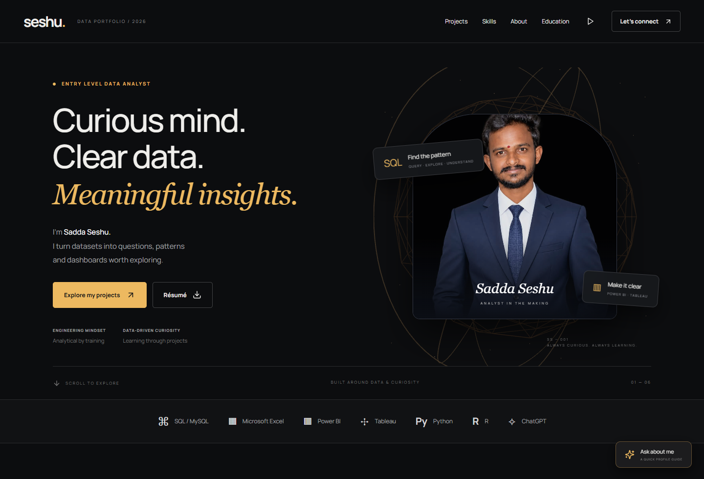
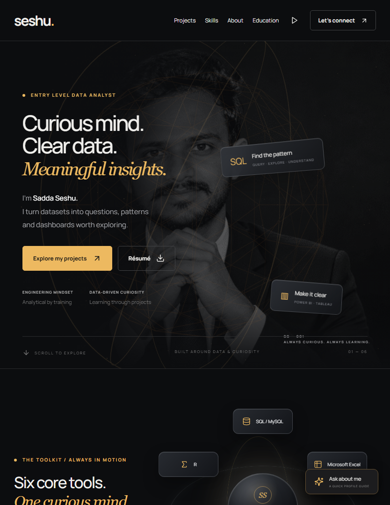
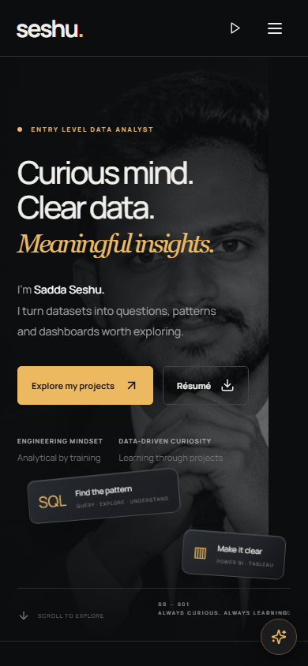
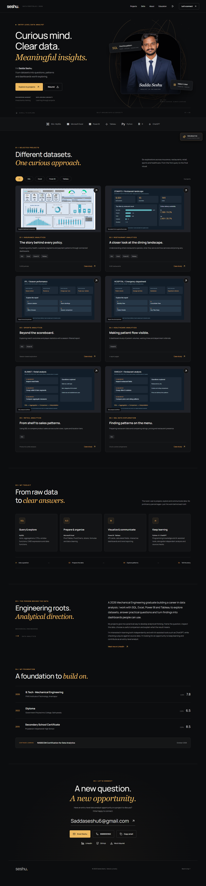
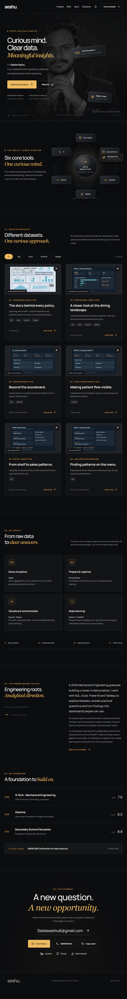
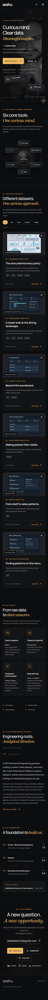
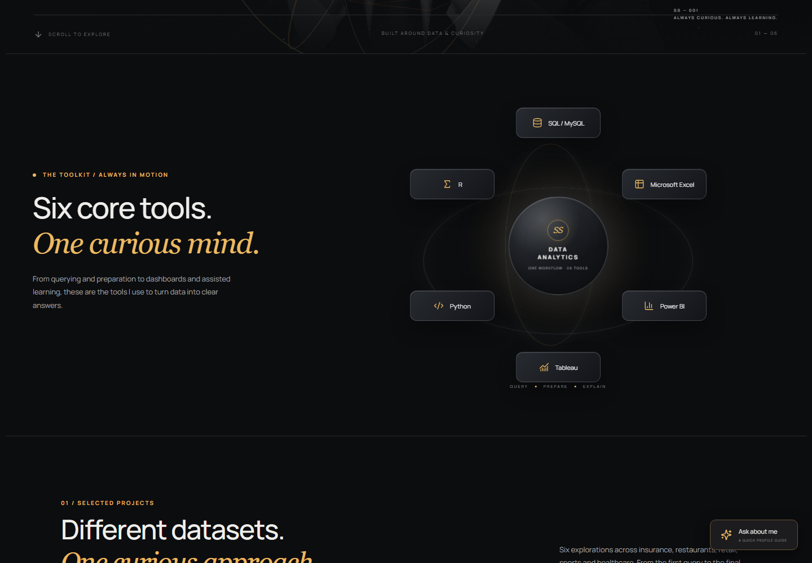
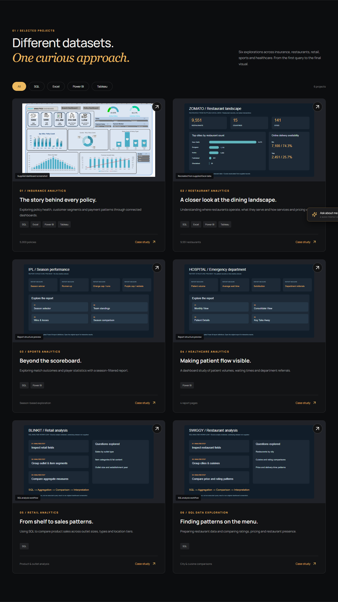
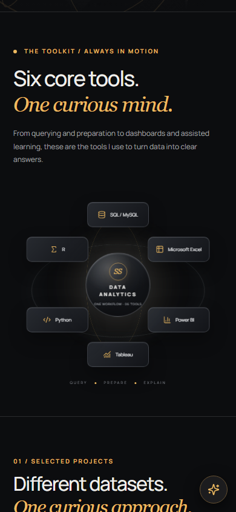
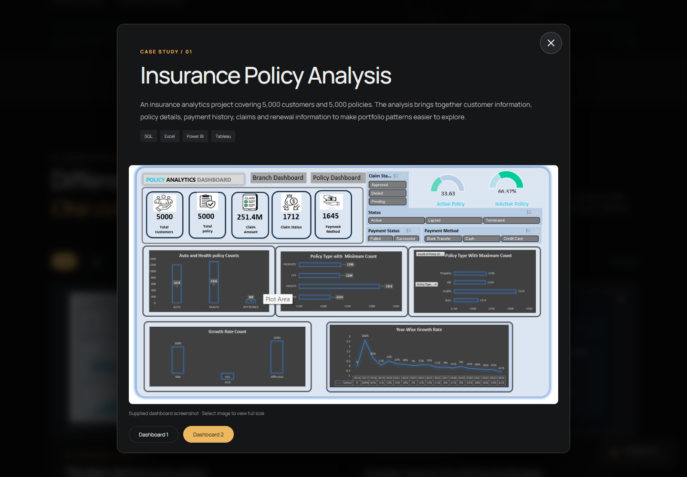

# Sadda Seshu — Data Analytics Portfolio

A responsive portfolio presenting six data analytics case studies, technical skills, education, a résumé, and contact details. Built with React and Vite and deployed to GitHub Pages.

[**Open the live portfolio →**](https://saddaseshu6-blip.github.io/sadda-seshu-data-analytics-portfolio/)

## Screenshots

These screenshots were captured from the production build at desktop, tablet, and mobile viewport sizes.

### Desktop · 1440 × 1000



### Tablet · 834 × 1080



### Mobile · 390 × 844



<details>
<summary>View full-page desktop, tablet, and mobile screenshots</summary>

#### Desktop



#### Tablet



#### Mobile



</details>

### Interactive portfolio sections

| Six-tool desktop orbit | Selected projects |
| --- | --- |
|  |  |

### Mobile skills orbit



### Project case study



## Highlights

- Full-bleed monochrome portrait hero with layered, glass-style project callouts.
- Animated orbit for SQL/MySQL, Microsoft Excel, Power BI, Tableau, Python, and R, arranged around a stationary center.
- Pause control and reduced-motion support for animation.
- Six interactive case studies, technology filters, project galleries, direct GitHub repository links, and a profile FAQ.
- Responsive layouts, accessible navigation, keyboard-friendly dialogs, and downloadable PDF and Word résumés.
- No backend, API keys, analytics, or external image/font requests.

## Technology

| Component | Version |
| --- | --- |
| React / React DOM | 19.3.1 |
| Vite | 7.3.7 |
| Three.js | 0.180.0 |
| Lucide React | 0.468.0 |
| Simple Icons | 15.22.0 |
| ESLint | 9.39.5 |
| Node.js | 22.12 or newer |
| npm | 10 or newer |
| GitHub Actions | Node.js 22 |

Exact dependency versions are recorded in `package-lock.json`. The site uses locally bundled Manrope and DM Sans fonts.

## Run locally

Install Node.js 22.12 or newer, then run these commands from the repository root:

```sh
npm ci
npm run dev
```

Open the local URL printed by Vite (by default, `http://127.0.0.1:5186`).

## Validate and build

```sh
npm test
npm run lint
npm run build
npm run preview
```

Vite writes the production site to `dist/`. Deploy the contents of that directory to a static host; do not open `index.html` directly with a `file://` URL.

## Deploy

GitHub Actions installs the locked dependencies, builds the production site, and deploys `dist/` to GitHub Pages whenever changes are pushed to `main`. If Pages has not been enabled yet, select **Settings → Pages → Build and deployment → GitHub Actions** in the GitHub repository.

## Repository layout

```text
.github/workflows/static.yml  GitHub Pages deployment
public/images/                Portrait, dashboard images, and project previews
public/resume/                PDF and Word résumés
src/App.jsx                   Portfolio sections and interactions
src/Scene.jsx                 Optional Three.js hero background
src/SkillsOrbit.jsx           Rotating analytics skills orbit
src/hero.css                  Hero and skills-orbit styling
src/profile.js                Portfolio, project, education, and skills content
tests/portfolio.test.mjs      Portfolio content and asset tests
previews/                     README screenshots
```

## Project-data notes

The policy dashboard uses supplied screenshots. The Zomato visual was recreated from the supplied Excel data. IPL and Hospital are labelled report-structure previews, not exported dashboards. Blinkit and Swiggy are labelled SQL workflow illustrations because their datasets were not supplied. See [CONTENT-SOURCES.md](CONTENT-SOURCES.md) for details.

Project experience is presented as portfolio work, not employment. Education details and scores should be verified against original records before publication. No hiring outcome or ATS score is guaranteed.
